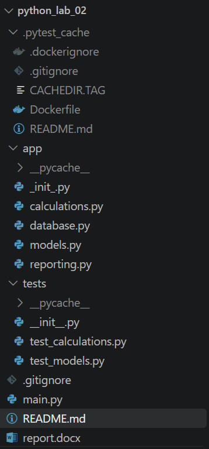
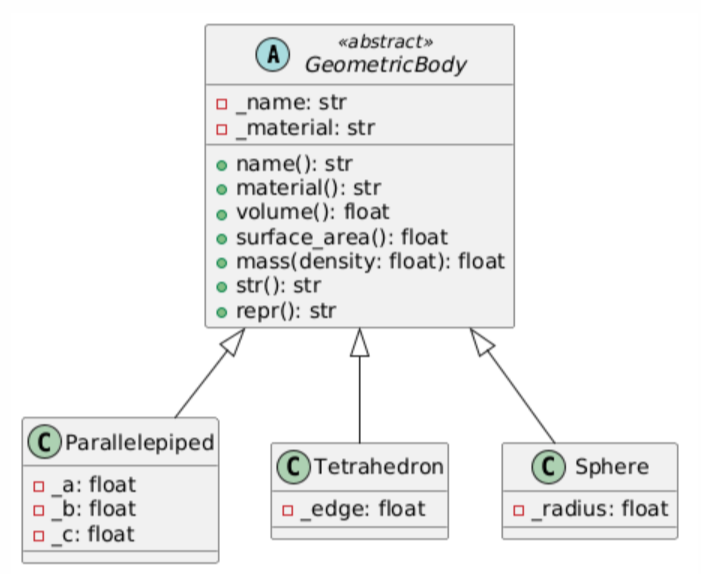

# python_lab_02
# Калькулятор геометрических тел

## Суть программы

Программа вычисляет **объём, площадь поверхности и массу** геометрических тел (параллелепипед, тетраэдр, шар) в зависимости от выбранного материала. 

Программа построена на принципах **ООП** (абстрактный базовый класс, наследование, managed-атрибуты, dunder-методы), покрыта тестами `pytest`, сохраняет историю расчётов в базу данных SQLite и может быть запущена в Docker-контейнере.

---

## Как использовать

### Ввод типа фигуры

Программа поддерживает три типа геометрических тел:

**1. Параллелепипед:**
Введите длину a: 2
Введите ширину b: 3
Введите высоту c: 4

**2. Тетраэдр (правильный):**
Введите длину ребра: 5

**3. Шар:**
Введите радиус: 1.5

### Выбор материала

Для каждого тела указывается материал, плотность которого используется при расчёте массы:

| Материал  | Плотность, кг/м³ |
|-----------|------------------|
| сталь     | 7800             |
| алюминий  | 2700             |
| дерево    | 700              |
| пластик   | 1200             |

### Формат ввода параметров

Все размеры вводятся в **метрах**, могут быть целыми или дробными числами. Отрицательные и нулевые значения недопустимы — программа выдаст ошибку.

**Примеры:**
- Длина: `2`, `3.5`, `10.25`
- Радиус: `1`, `0.5`

---

## Как читать результат

Программа показывает:

1. **Введённые параметры** — тип фигуры, размеры, материал.
2. **Результаты расчёта**:
   - Название фигуры
   - Материал
   - Объём (м³)
   - Площадь поверхности (м²)
   - Масса (кг)
3. **Уведомление о сохранении** — результат автоматически попадает в БД SQLite.
4. **Предложение сохранить отчёт** — в формате `.xlsx` (Excel) или `.docx` (Word).
5. **История расчётов** — доступна через пункт меню `4`.

### Пример:

**Ввод:**
Фигура: Шар
Радиус: 1
Материал: сталь

**Результат:**
Название: Шар
Материал: сталь
Объем (м^3): 4.1888
Площадь поверхности (м^2): 12.5664
Масса (кг): 32672.56

*Формулы:*
- Объём шара: `V = 4/3 · π · R³`
- Площадь поверхности: `S = 4 · π · R²`
- Масса: `m = V · ρ`

---

## Архитектура проекта


### UML-схема классов


---

## Автотесты

Проект включает **7 юнит-тестов**, проверяющих корректность работы всех компонентов.

### Что проверяется:

- Расчёты объёма, площади поверхности и массы для всех трёх тел.
- Корректность работы сеттеров (валидация отрицательных значений).
- Работа фабрики `create_body` (создание объектов по типу).
- Обработка ошибок (неизвестный материал, неверный тип фигуры).
- Формат выходных данных `calculate_all`.
- Dunder-методы (`__str__`, `__repr__`).

### Запуск тестов:

python -m pytest -v

### Ожидаемый результат:

tests/test_calculations.py::test_create_body_valid PASSED
tests/test_calculations.py::test_create_body_invalid PASSED
tests/test_calculations.py::test_calculate_all PASSED
tests/test_models.py::test_parallelepiped_calculations PASSED
tests/test_models.py::test_tetrahedron_calculations PASSED
tests/test_models.py::test_sphere_calculations PASSED
tests/test_models.py::test_managed_attributes_validation PASSED

============================= 7 passed in 0.05s ==============================
## Технические требования
### Системные требования:
Python: 3.10 или новее (проверено на 3.13).
Docker Desktop (для запуска в контейнере) — Windows 10/11 с WSL2.
ОС: Windows / Linux / macOS.
Минимальные характеристики: 1 ГБ RAM, 200 МБ свободного места.

### Библиотеки (см. requirements.txt):
Библиотека	Назначение
python-docx	Сохранение отчётов в формате Word
openpyxl	Сохранение отчётов в формате Excel
pytest	Юнит-тестирование
sqlite3	Встроенная библиотека для БД

### Поддерживаемые фигуры и материалы:
Фигуры: Параллелепипед, Тетраэдр, Шар.
Материалы: сталь, алюминий, дерево, пластик.
Единицы измерения: метры (м), килограммы (кг).

### Ограничения:
Поддерживаются только три типа геометрических тел (по варианту 16).
Плотности материалов заданы фиксированно в коде.
Масса рассчитывается в килограммах.
База данных сохраняется в файл calculations.db в корне проекта.

## Как запустить
### Вариант 1: Локально (рекомендуемый для разработки)
1. Клонируйте репозиторий:
    ``bash
    git clone https://github.com/<ваш-логин>/python_lab_02.git
    cd python_lab_02
2. Установите зависимости:
    ```bash
    pip install -r requirements.txt
3. Запустите программу:
    ```bash
    python main.py
4. (Опционально) Запустите тесты:
    ```bash
    python -m pytest -v

### Вариант 2: Через Docker
1. Соберите образ:
    ```bash
    docker build -t geo-calculator .
2. Запустите контейнер с монтированием папки:
    ```bash
#### Windows (PowerShell)
docker run -it --rm -v ${PWD}:/app geo-calculator

#### Linux / macOS
docker run -it --rm -v $(pwd):/app geo-calculator

## Примеры использования
### Пример 1: Параллелепипед из стали
#### Ввод:

Фигура: 1 (Параллелепипед)
a = 2, b = 3, c = 4
Материал: сталь

#### Результат:

Объем (м^3): 24.0
Площадь поверхности (м^2): 52.0
Масса (кг): 187200.0

#### Проверка:

V = a · b · c = 2 · 3 · 4 = 24 м³

S = 2·(ab + bc + ac) = 2·(6 + 12 + 8) = 52 м²

m = V · ρ = 24 · 7800 = 187200 кг

### Пример 2: Тетраэдр из алюминия
#### Ввод:

Фигура: 2 (Тетраэдр)
Ребро = 3
Материал: алюминий

#### Результат:

Объем (м^3): 3.1819
Площадь поверхности (м^2): 15.5885
Масса (кг): 8591.13

#### Формулы:

V = a³ / (6·√2)

S = √3 · a²

m = V · ρ

### Пример 3: Шар из дерева
#### Ввод:

Фигура: 3 (Шар)
Радиус = 0.5
Материал: дерево

#### Результат:

Объем (м^3): 0.5236
Площадь поверхности (м^2): 3.1416
Масса (кг): 366.52

#### Формулы:

V = 4/3 · π · R³

S = 4 · π · R²

m = V · ρ

### Пример 4: Просмотр истории расчётов
#### Ввод:

Выберите действие: 4

#### Результат:

=== История расчетов ===
[2025-01-15 14:23:05] Параллелепипед (сталь) -> {"Название": "Параллелепипед", ...}
[2025-01-15 14:24:12] Шар (дерево) -> {"Название": "Шар", ...}
[2025-01-15 14:25:40] Тетраэдр (алюминий) -> {"Название": "Тетраэдр", ...}